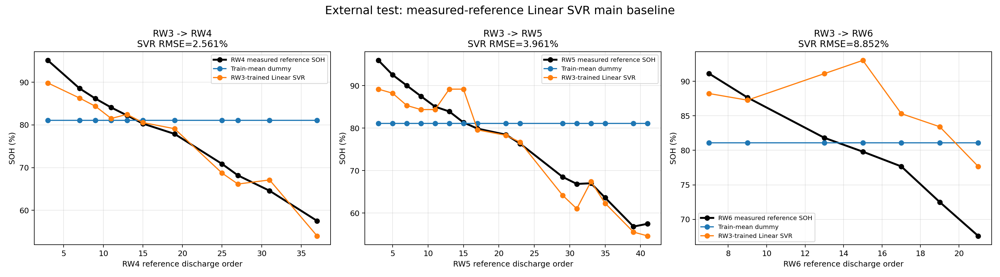
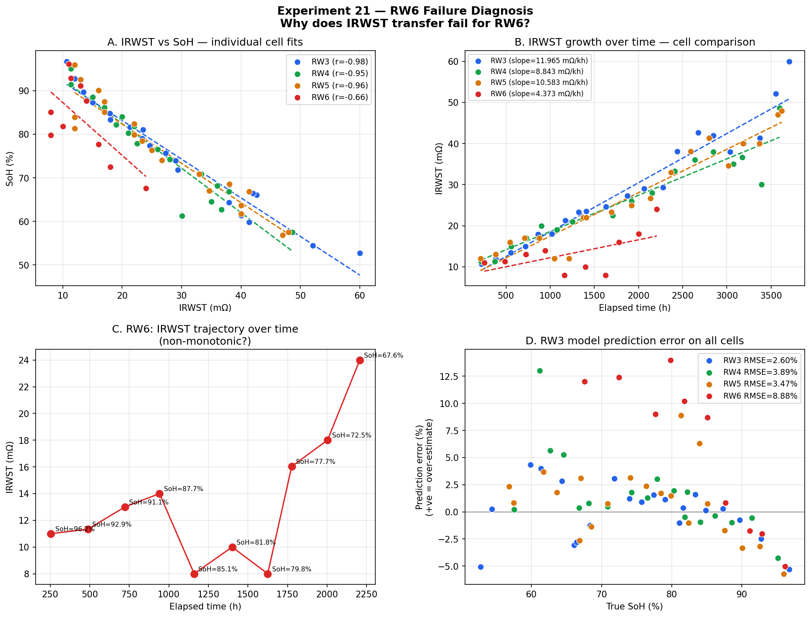

# Battery State-of-Health (SoH) Estimation from 5-Second Discharge Pulses

Can the state of health of a lithium-ion cell be estimated from only the **first 5 seconds** of a discharge pulse?
This independent undergraduate project (Advanced Material Research Group, National Taiwan University, Jun 2026 – present)
answers that question with a short-time internal-resistance indicator, a simple linear model, and a deliberately strict validation design.

## Key results

| Finding | Result |
|---|---|
| Controlling the starting-voltage window (4.0–4.2 V) | Test RMSE dropped from ~20% to **4.2%** |
| Cross-cell generalization (train on RW3, test on unseen RW4) | RMSE **4.2%** |
| Main baseline on measured-capacity labels (Linear SVR + IRWST) | Final-test RMSE **3.5%** (small test set, 4 pairs) |
| Anomalous cell RW6: 3 periodic calibration points | Error reduced from **11.6% to 4.9%** |

**Honest caveat.** On the same held-out data, a simple elapsed-time baseline predicted SoH slightly better than IRWST alone.
Partial-correlation tests (Exp. 19–20) were inconclusive because IRWST and elapsed time are highly collinear (r ≈ 0.92–0.97).
IRWST remains useful because it can be measured directly from a short pulse, whereas a reliable aging clock is often unavailable in practice.

## Method

- **Data:** NASA *Randomized Battery Usage 2: Room Temperature Random Walk* (cells RW3–RW6).
- **Labels:** capacity-based SoH from reference discharges, `SoH = Q / Q0 × 100`, via Ah integration.
- **Feature (IRWST):** internal resistance within a short time, `(V_start − V_5s) / I_5s`, from random-walk discharges that start at 4.0–4.2 V.
- **Models:** Linear SVR (main) and linear regression (interpretable comparator), against a train-mean dummy and an elapsed-time baseline.
- **Validation:** chronological and reference-interval-aware (group-aware) splits to prevent leakage, measured-reference labels instead of interpolated ones, and external tests on unseen cells.
- **Diagnosis (Exp. 21):** RW6 fails to transfer because its resistance grows at about one-third the typical rate, follows a non-monotonic trajectory, and has a 37% steeper IRWST–SoH slope.

The full experiment record (21 experiments, including failed ones) is in [PROJECT_LOG.md](PROJECT_LOG.md).





## Repository layout

```
src/                 analysis and training scripts (one script per experiment)
data/processed/      feature tables and result summaries (CSV)
outputs/             figures
archive/             earlier exploratory work, kept for traceability (not the audited baseline)
PROJECT_LOG.md       experiment log
```

## How to run

1. Download `RW3.mat` – `RW6.mat` from the [NASA PCoE data repository](https://www.nasa.gov/intelligent-systems-division/discovery-and-systems-health/pcoe/pcoe-data-set-repository/) (Randomized Battery Usage 2) and place them in `data/raw/`.
2. Install dependencies: `pip install -r requirements.txt`
3. Build a feature table: `python src/build_feature_table.py RW3`
4. Train and evaluate the main baseline: `python src/train_measured_reference_baseline.py`, then `python src/evaluate_main_baseline_external_cells.py`

## Reference

Jia et al. (2022), *iScience* — inspiration for the short-time health indicators: <https://doi.org/10.1016/j.isci.2022.103988>.
This project is an independent baseline, not a reproduction of that paper.

## Author

Tzu-Ying Yang, Department of Biomechatronics Engineering, National Taiwan University · Advisor: Prof. Hsun-Yi Chen
